<p align="center">
  
</p>

<h1 align="center">Greedy Trap</h1>

<p align="center">
  A browser puzzle game made of seven small optimisation problems.<br>
  Every level is picked so that the obvious greedy strategy gets it wrong.
</p>

<p align="center">
  <a href="https://edward-012.github.io/greedy-trap/"><b>Play it in your browser</b></a>
</p>

<p align="center">
  <a href="https://github.com/EDWARD-012/greedy-trap/actions/workflows/ci.yml"></a>
</p>

<p align="center">
  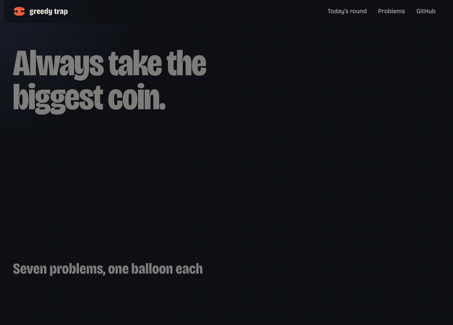
</p>

You look for the answer greedy misses, and an exact solver judges it with a contest-style verdict. The level in the clip above sits on the front page, so you can play within a few seconds of opening the site.

I build RL environments and automated graders for AI evaluation work. A grader is only worth something if you can check it, so this game is put together the way I would put one of those together: a seeded task generator, a baseline to beat, a reference solution, and a judge whose claims are each backed by a test.

## The seven problems

<table>
  <tr>
    <td align="center" width="33%">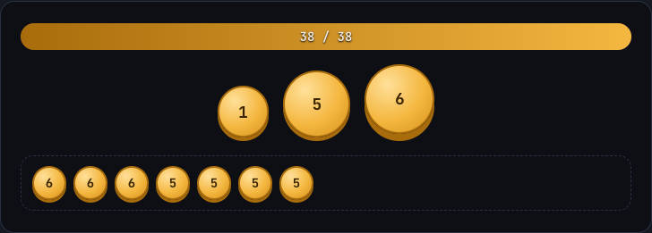<br><b>A. Exact change</b></td>
    <td align="center" width="33%">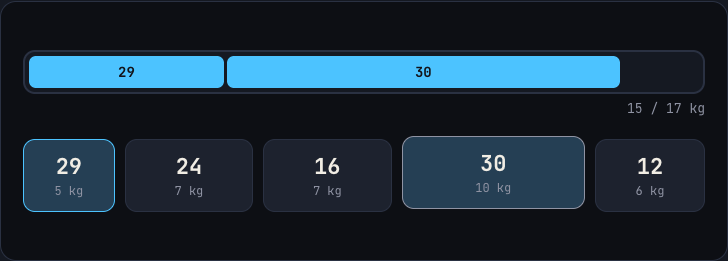<br><b>B. Carry-on</b></td>
    <td align="center" width="33%">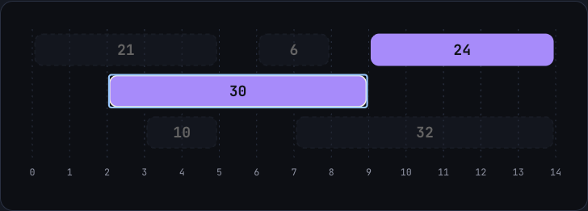<br><b>C. Double booked</b></td>
  </tr>
  <tr>
    <td align="center" width="33%">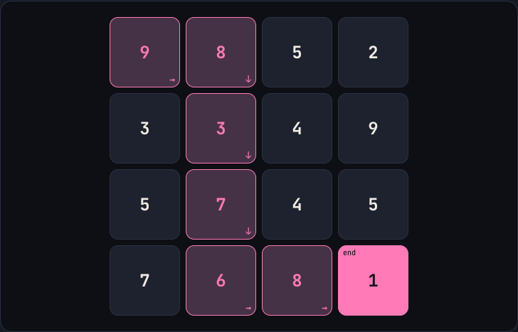<br><b>D. Down and right</b></td>
    <td align="center" width="33%">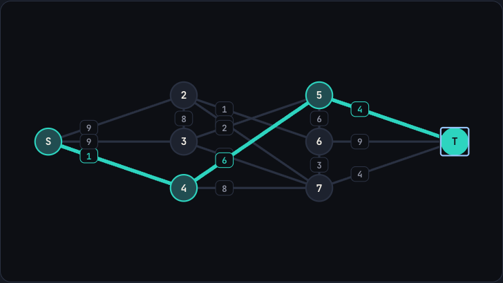<br><b>E. Toll roads</b></td>
    <td align="center" width="33%">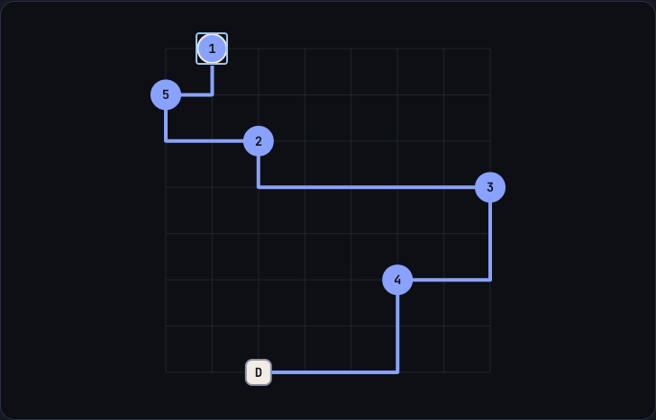<br><b>F. Last mile</b></td>
  </tr>
  <tr>
    <td align="center" width="33%">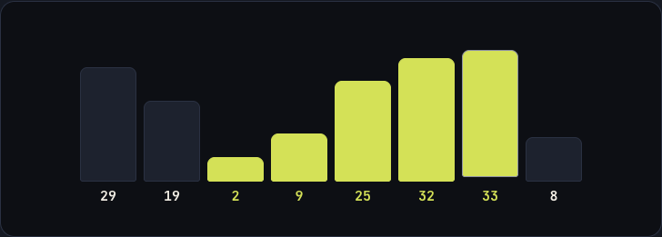<br><b>G. Staircase</b></td>
    <td colspan="2">Each board is shown with an optimal answer on it. Your answer is painted in the problem's own colour, greedy's in red and the optimum in green, so the three never get mixed up.</td>
  </tr>
</table>

| | Problem | The greedy you play against | What solves it |
| --- | --- | --- | --- |
| A | Exact change | Keep taking the largest coin that still fits. | Dynamic programming over amounts |
| B | Carry-on | Sort by value per unit of weight and take every item that still fits. | 0/1 knapsack DP |
| C | Double booked | Take the best-paid gig that does not clash with what you already took, and repeat. | Weighted interval scheduling: sort by end time, binary search, DP |
| D | Down and right | Step onto whichever neighbour, right or down, holds more gold. On a tie go right. | DP over the grid |
| E | Toll roads | From the town you are in, take the cheapest road to a town you have not visited. | Dijkstra's algorithm with a binary heap |
| F | Last mile | Always drive to the nearest stop you have not visited. On a tie take the lower-numbered stop. | Bitmask DP (Held-Karp) |
| G | Staircase | Take the first card, then every later card that is larger than your last pick. | Longest increasing subsequence with binary search |

## Three tabs on every problem

### Solve

You work the level out on the board and submit. The answer goes through up to three tests in order: it follows the rules, it beats greedy, it matches the optimum. The verdict names the first test it fails. An accepted answer earns that problem's balloon, the way a contest hands one out, and an answer that matches greedy makes the trap snap shut.

<table>
  <tr>
    <td width="50%">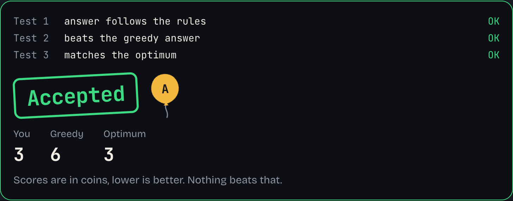</td>
    <td width="50%">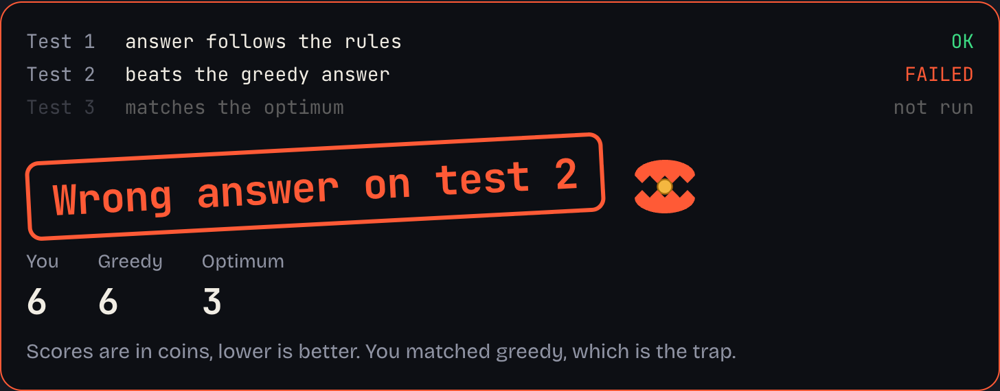</td>
  </tr>
</table>

### Hack

This turns the game around. You write an input in the problem's input format, the way you would for a hack in a contest. A validator checks it against the constraints, then greedy and the exact solver both run on it. If greedy comes out worse, the hack succeeds and you can play your own test.

<p align="center">
  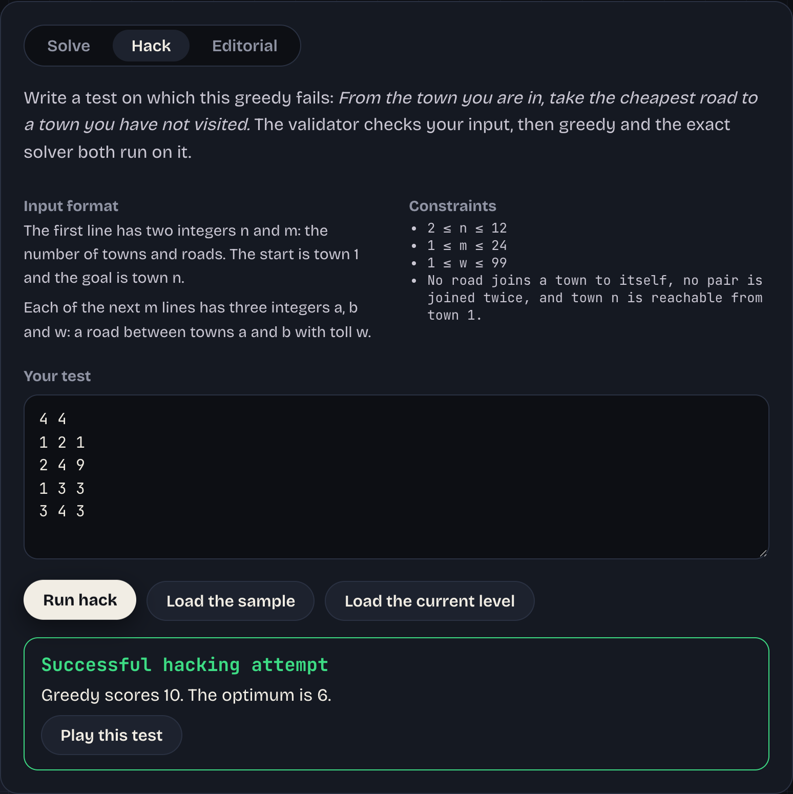
</p>

### Editorial

Each problem explains why the greedy fails and which technique gets it right, with the recurrence and the running time. After you solve a level it also shows the solver's table for that exact test, and you can put greedy's answer and the optimal one on the board to compare.

<p align="center">
  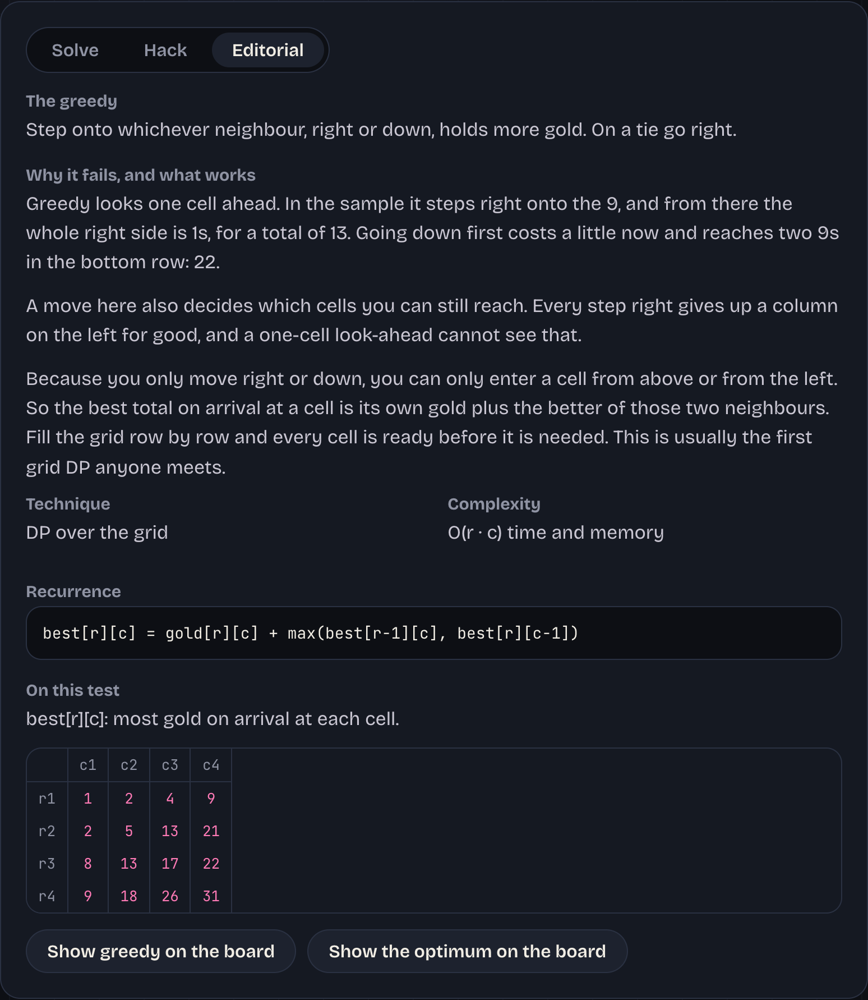
</p>

## The daily round

One level of each problem, the same for everyone, changing at midnight UTC. It is scored like an ICPC contest: by problems solved, then by penalty, which is the minutes to each accepted answer plus 20 for every wrong submission before it. The site is a single static page, so it plays the same on a phone.

<table>
  <tr>
    <td width="72%">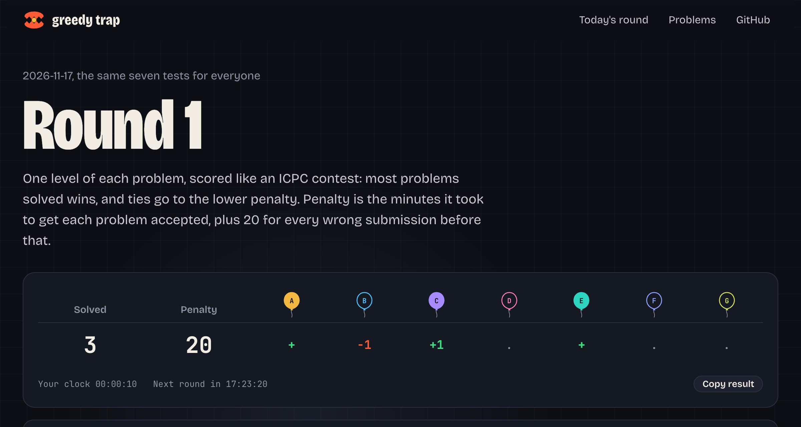</td>
    <td width="28%">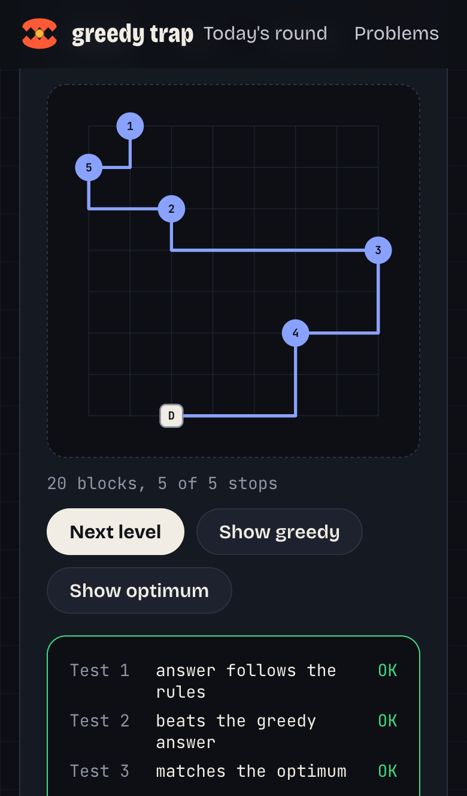</td>
  </tr>
</table>

## Quickstart

Needs Node 22 or newer.

```bash
git clone https://github.com/EDWARD-012/greedy-trap.git
cd greedy-trap
npm ci
npm test
npm run dev
```

`npm run dev` prints a local address to open. `npm run build` writes the static site to `dist/`.

The browser tests need Playwright's browsers once, then one command:

```bash
npx playwright install
```

```bash
npm run e2e
```

## A worked example

`npm run example` takes practice level 1 of problem A and prints this:

```text
Problem A. Exact change, practice level 1 (seed coins/practice/1)

Input
  3 16
  1 5 6

Greedy pays  6 6 1 1 1 1  (6 coins)
Solver pays  6 5 5  (3 coins)

Four answers through the judge
  6 5 5        Accepted
  6 6 1 1 1 1  Wrong answer on test 2 (beats the greedy answer)
  5 5 5 1      Wrong answer on test 3 (matches the optimum)
  6 6 6        Wrong answer on test 1 (answer follows the rules)
```

The coins are 1, 5 and 6 and the target is 16. Largest-first takes two 6s and is left paying 4 in ones. The third answer is better than greedy but one coin over the optimum, so it gets past test 2 and fails test 3. The last one adds up to 18, not 16, so it never gets a score at all.

## How the judging works, and why you can trust it

Each problem is one file in `src/core/problems/` with five separate parts: a random test generator, the greedy, an exact solver, an input validator for hacks, and a function called `value()`.

`value()` is the only code that decides whether an answer is legal and what it scores. It takes the answer as `unknown` and checks everything about it, so the judge does not depend on the interface having behaved. `tests/judge.test.ts` feeds it 25 rule-breaking answers (a negative coin count, the same item packed twice, a road that does not exist, a skipped stop and so on) and each one has to fail test 1.

The solvers are the part that could be quietly wrong, so each one is compared with a brute-force search in `tests/brute.ts` on 150 random tests at each of the three sizes. The brute-force code shares nothing with the solvers and works differently: breadth-first search for the coins, every subset for the knapsack, gigs and cards, every path for the grid and the roads, every order for the courier.

The judge also checks itself while it runs. If greedy or a player's answer ever scores better than the reference solver, it throws an error and refuses to give a verdict.

Levels come from a seed. The seed string is hashed with FNV-1a into a mulberry32 generator, and random tests are drawn until one is a trap. The same seed gives the same level on every machine, and a test pins level 1 of every problem so that a change to a generator cannot slip through unnoticed.

The interface is tested by playing it. `e2e/smoke.spec.ts` drives a real browser: it solves the level on the front page, solves one level of every problem by clicking the board, submits the greedy answer and expects "Wrong answer on test 2", runs hacks, and plays a daily round through to the standings. It runs in Chromium, Firefox and WebKit and at a phone-sized viewport, and any console error fails the test.

The numbers in this README are checked as well. `tests/readme.test.ts` regenerates the worked example above and the table below, and fails if this file says anything different.

## How often greedy loses

`npm run stats` draws 2000 random tests per problem and size from seed 7780 and prints this table:

| Problem | Solver | Greedy loses: small | medium | large | Mean gap (medium) | Worst gap (medium) |
| --- | --- | --- | --- | --- | --- | --- |
| A. Exact change | Dynamic programming over amounts | 9.0% | 22.3% | 35.5% | 75.3% | 400.0% |
| B. Carry-on | 0/1 knapsack DP | 27.7% | 37.0% | 44.5% | 9.7% | 50.9% |
| C. Double booked | Weighted interval scheduling: sort by end time, binary search, DP | 17.9% | 29.9% | 41.1% | 19.3% | 56.8% |
| D. Down and right | DP over the grid | 18.1% | 34.9% | 50.0% | 9.5% | 40.4% |
| E. Toll roads | Dijkstra's algorithm with a binary heap | 58.7% | 69.0% | 77.0% | 85.5% | 540.0% |
| F. Last mile | Bitmask DP (Held-Karp) | 20.6% | 39.6% | 51.9% | 15.6% | 62.5% |
| G. Staircase | Longest increasing subsequence with binary search | 49.2% | 64.8% | 74.5% | 41.6% | 83.3% |

"Greedy loses" is the share of random tests on which greedy does not reach the optimum. Those are the tests the game keeps as levels. The gap is how far greedy's score is from the optimum, as a share of the optimum, averaged over the tests it loses. For the problems where lower is better (A, E, F) it can go past 100%: a gap of 100% means greedy paid double.

Small, medium and large are the three level sizes. Practice levels 1 to 3 are small, 4 to 8 are medium and the rest are large. The daily round uses medium.

## Layout

```text
src/core/            game logic with no UI and no dependencies
  problems/          the seven problems
  judge.ts           verdicts and hack checking
  levels.ts          seeded levels and daily rounds
  stats.ts           the table above
src/ui/              the React interface
tests/               brute-force checks, judge, levels, README
e2e/                 browser tests that play the game
scripts/             npm run stats, npm run example, npm run shots
docs/                the images in this README
```

The images in this README are not made by hand. `npm run shots` builds the site, plays it in a headless browser and takes them again. The GIF step needs Python with Pillow.

Dependencies are pinned to exact versions in `package.json` and `package-lock.json`. GitHub Actions runs the type check, the unit tests, the build and the browser tests on every push to `main` and on pull requests, and publishes the site from `main` only if all of them pass.

## Limits

- The tests are small on purpose, so that a person can play them and brute force can check them. Nothing here says how the solvers behave on large inputs.
- Each problem has one greedy rule. Other heuristics for the same problem are not covered.
- A level counts as a trap when greedy is worse than the optimum by any amount. Sometimes that is a single coin.
- The solvers are tested against brute force on random tests. That is evidence, not a proof.
- There is no server. Progress lives in your browser's local storage, the daily standings show only your own row, and the round clock is your device's clock. Everything runs in the page, so anyone who reads the source can compute the answers. It is a game, not a proctored contest.
- The browser tests run in Playwright's Chromium, Firefox and WebKit builds. WebKit is Safari's engine, but it is not Safari, and the phone test is a phone-sized viewport on a desktop machine. Real Safari and real phones have not been tried.
- The browser tests check that the game works and that animated things end up where they should. Whether the motion feels right is a matter of taste and no test covers it.
- Hack inputs are capped at the sizes listed under each problem's constraints.

## Licence

MIT. See [LICENSE](LICENSE).
